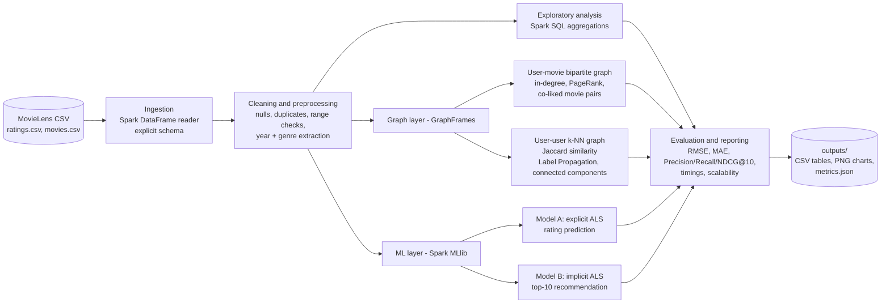
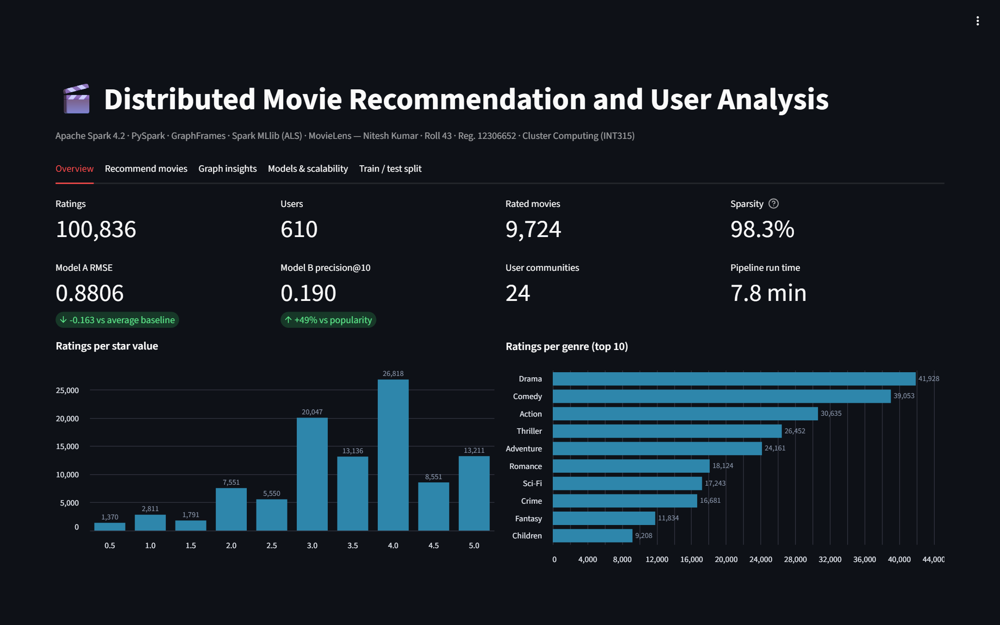

# Distributed Movie Recommendation and User Analysis System

| | |
|---|---|
| **Name** | Nitesh Kumar |
| **Roll number** | 43 |
| **Registration number** | 12306652 |
| **Course** | Cluster Computing (INT315) |

Built with **Apache Spark 4.2 (PySpark)**, **GraphFrames** (the DataFrame-based GraphX API for Python) and **Spark MLlib ALS**, using the **MovieLens** dataset.

**Live dashboard:** https://movie-recommendation-spark.onrender.com (free hosting: the first visit after a quiet spell can take about a minute to wake up)

> **Why GraphFrames instead of GraphX?** GraphX only has a Scala/Java API. GraphFrames is the official graph library for PySpark. It runs on the same Spark engine, and its connected-components step uses GraphX internally (`algorithm="graphx"`).

---

## 1. System architecture (Task 1)



| Layer | Spark component | What it does |
|---|---|---|
| Storage | Local CSV files (HDFS/S3 in a real cluster) | Raw MovieLens data |
| Processing | Spark SQL / DataFrames | Cleaning, joins, aggregations; work is split into partitions across cores |
| Graph | GraphFrames (GraphX underneath) | PageRank, degrees, Label Propagation, connected components |
| ML | Spark MLlib (`ALS`, `TrainValidationSplit`, `RegressionEvaluator`, `RankingEvaluator`) | Training, tuning, evaluation |
| Driver | `run_pipeline.py` | Runs the stages, times them and saves the results |

The same code runs on a real cluster: change `.master("local[*]")` in [src/spark_session.py](src/spark_session.py) to the cluster URL (for example `spark://host:7077` or `yarn`) and point `--data-dir` at HDFS or S3.

---

## 2. Project structure

```
cluster/
├── run_pipeline.py          # runs every stage end to end
├── show_train_test_split.py # shows the train/test split and saves screenshots of it
├── verify.py                # automated PASS/FAIL checks of the results
├── export_dashboard_data.py # saves top-10 recommendations for every user
├── dashboard/app.py         # Streamlit dashboard (reads outputs/, no Spark needed)
├── presentation/            # project slides (PowerPoint)
├── requirements.txt
├── data/ml-latest-small/    # MovieLens dataset (100,836 ratings)
├── jars/                    # GraphFrames jars for Spark 4 (from Maven Central)
├── src/
│   ├── spark_session.py     # SparkSession setup
│   ├── ingest.py            # Task 2: load, clean, explore
│   ├── graph_analysis.py    # Task 3: graph construction and algorithms
│   ├── recommender.py       # Task 4: ALS models, tuning, metrics
│   ├── scalability.py       # Task 5: data-size and core-count experiments
│   └── plots.py             # charts
└── outputs/                 # generated tables, charts and metrics.json
```

---

## 3. How to run

**Requirements:** Python 3.10 or newer, Java 17 or newer (tested on Java 23).

```bash
pip install -r requirements.txt
```

The `jars/` folder already holds the three GraphFrames jars. To download them again:

```bash
curl -L -o jars/graphframes-spark4_2.13-0.12.3.jar https://repo1.maven.org/maven2/io/graphframes/graphframes-spark4_2.13/0.12.3/graphframes-spark4_2.13-0.12.3.jar
curl -L -o jars/graphframes-graphx-spark4_2.13-0.12.3.jar https://repo1.maven.org/maven2/io/graphframes/graphframes-graphx-spark4_2.13/0.12.3/graphframes-graphx-spark4_2.13-0.12.3.jar
curl -L -o jars/java-semver-0.10.2.jar https://repo1.maven.org/maven2/com/github/zafarkhaja/java-semver/0.10.2/java-semver-0.10.2.jar
```

Run the pipeline (about 10 minutes for everything, about 5 without the scalability runs):

```bash
python run_pipeline.py
```

```bash
python run_pipeline.py --skip-scaling --skip-tuning
```

To see the train/test split used by the models (sizes, overlap checks, sample rows) and save screenshots of it to `outputs/split_*.png`:

```bash
python show_train_test_split.py
```

Useful options: `--user 42` (whose recommendations to show), `--cores 4`, `--knn 10`, `--data-dir data/ml-25m` (any MovieLens CSV dataset, for bigger scalability tests).

> **Windows note:** the jars are loaded with `spark.driver.extraClassPath` instead of `spark.jars.packages`, and results are saved with pandas instead of Spark writers. Together these avoid the usual `winutils.exe` / `HADOOP_HOME` error on Windows.

---

### Dashboard

The dashboard has five tabs:
- **Overview:** dataset stats and key results
- **Recommend movies:** pick any user (1–610) to see their favourites next to their top-10 recommendations
- **Graph insights:** PageRank, communities and movies liked together
- **Models & scalability:** model results and scaling experiments
- **Train / test split:** the split screenshots and rating balance



It only reads saved results, so it runs without Spark. Recommendations for every user come from `export_dashboard_data.py`, which needs a pipeline run first.

To run it locally:

```bash
pip install -r dashboard/requirements.txt
```

```bash
streamlit run dashboard/app.py
```

The live version is hosted on Render's free plan. It installs `dashboard/requirements.txt` and redeploys on every push to `main`.

---

## 4. What each task does

### Task 2: Ingestion and preprocessing ([src/ingest.py](src/ingest.py))
- Reads the CSVs with an **explicit schema**, so Spark doesn't need an extra pass to guess column types.
- Cleaning: drops nulls, keeps ratings between 0.5 and 5, removes duplicate (user, movie) pairs, and drops ratings for unknown movies.
- Feature extraction: release **year** from the title, a **genre list** from `Action|Comedy|...`, and a timestamp converted to a date.
- Distributed analysis: dataset size and sparsity, rating distribution, top-rated movies (minimum 50 ratings), ratings per genre, and ratings per user.

### Task 3: Graph analysis ([src/graph_analysis.py](src/graph_analysis.py))
| Graph | Vertices / edges | Algorithm | Answers |
|---|---|---|---|
| User-movie (bipartite) | users + movies / one edge per rating | **In-degree** | Which movies are most popular? |
| | | **PageRank** (undirected) | Which movies and users are most central or influential? |
| | | **Co-liked pairs** (2-hop paths movie-user-movie) | Which movies are liked together? |
| User-user k-NN | users / each user linked to the 10 most similar users (Jaccard on liked movies) | **Label Propagation** | Which communities of similar-taste users exist, and what do they like? |
| | | **Connected components** | Is the taste network connected? |

*Why a k-NN graph?* The first version linked any two users who shared 20 or more liked movies. Heavy raters then became hubs that pulled everyone into one giant community. Jaccard similarity corrects for how much each user rates, and keeping only each user's top 10 neighbours keeps the graph balanced.

### Task 4: Machine learning ([src/recommender.py](src/recommender.py))
**ALS (Alternating Least Squares)** matrix factorisation. It learns a small vector of hidden "taste" factors for every user and every movie. The predicted score is the dot product of the two vectors.

- **Model A: explicit ALS.** Predicts the star rating. Tuned over rank {10, 20, 50} × regParam {0.05, 0.1, 0.2} with `TrainValidationSplit`.
- **Model B: implicit ALS.** Treats each rating as a signal that the user watched the movie, with the rating as confidence. Builds top-10 lists. Tuned over rank × alpha × regParam by NDCG@10 on a validation split taken from the training data. The test set is never used for tuning.
- Both models recommend only movies with at least 20 training ratings, and never recommend movies the user has already rated.

*Why two models?* Predicting a rating and ranking a top-10 list are different problems. Model A is best at RMSE but makes worse top-10 lists than simply recommending popular movies. Model B is trained for ranking and beats the popularity baseline clearly. See the results.

### Task 5: Evaluation ([src/scalability.py](src/scalability.py) and metrics in `recommender.py`)
- **Rating accuracy:** RMSE, MAE and R² on a held-out 20% test set, against a global-mean baseline and a per-movie-mean baseline.
- **Ranking quality:** Precision@10, Recall@10 and NDCG@10, against a popularity baseline.
- **Execution time:** recorded for every stage (`stage_seconds` in `metrics.json`).
- **Data scaling:** ALS trained on 25%, 50%, 75% and 100% of the data, measuring time and RMSE.
- **Core scaling:** the full workload (load, graph, ALS) on 1, 2, 4 and 8 cores, measuring time and speed-up.

---

## 5. Results (MovieLens small, 12-core laptop, `local[*]`)

Every number below comes from `outputs/metrics.json` (seed 42). The full console log is in `run_log.txt`.

### Data
| Users | Movies | Ratings | Avg rating | Sparsity |
|---|---|---|---|---|
| 610 | 9,724 | 100,836 | 3.50 | 98.3% |

98.3% sparsity means each user has rated fewer than 2% of the movies. Filling in the rest is the job of the recommender.

### Graph analysis
- **User-movie graph:** 10,352 vertices and 100,836 edges.
- **Most popular and most central movie:** *Forrest Gump (1994)*, top by both in-degree and PageRank. It's followed by *Shawshank Redemption*, *Pulp Fiction*, *The Matrix* and *Silence of the Lambs*.
- **Most liked-together pair:** *Shawshank Redemption* and *Forrest Gump*, liked by 168 of the same users.
- **User k-NN graph:** 609 users and 6,090 edges forming **1 connected component**, so every user in the graph can reach every other. The 610th user (ID 442) never rated anything above 2.5, so they have no liked movies to compare. Label Propagation finds **24 communities**.

| Community | Users | Genre it over-likes | Lift |
|---|---|---|---|
| C1 | 210 | Crime | 1.24 |
| C2 | 105 | Animation | 1.16 |
| C3 | 60 | Film-Noir | 2.75 |
| C4 | 58 | Western | 1.81 |
| C5 | 46 | Western | 2.33 |

A lift of 2.75 means community C3 likes Film-Noir 2.75 times more than the average user does.

### Model A: rating prediction (explicit ALS, rank 10, regParam 0.2)
| Model | Test RMSE | MAE |
|---|---|---|
| Predict the global average | 1.044 | – |
| Predict the movie's average | 0.963 | – |
| **ALS** | **0.881** | **0.691** |

ALS is about 16% more accurate than the global-average baseline. On average its predictions are within about 0.7 stars of the real rating.

### Model B: top-10 recommendation (implicit ALS, rank 50, alpha 1.0, regParam 0.1)
| Model | Precision@10 | Recall@10 | NDCG@10 |
|---|---|---|---|
| Popularity baseline | 0.127 | 0.098 | 0.164 |
| Explicit ALS (Model A) | 0.067 | 0.047 | 0.076 |
| **Implicit ALS (Model B)** | **0.190** | **0.210** | **0.261** |

Model B's top-10 lists contain about 1.9 movies the user really liked in the hidden test set, about 50% more than recommending popular movies. Model A, which is trained for RMSE, ranks worse than the baseline. That is why the project uses a separate model for each goal.

**Example (user 1)** likes *Tombstone*, *Pink Floyd: The Wall* and *Canadian Bacon*. Recommended: *Terminator 2*, *Die Hard*, *Raising Arizona*, *Jaws*, *Aliens* and others. See `outputs/recommendations_user_1.csv`.

### Scalability
| Data used | Ratings | ALS training time | Test RMSE |
|---|---|---|---|
| 25% | 25,228 | 4.1 s | 1.012 |
| 50% | 50,659 | 3.9 s | 0.934 |
| 75% | 75,844 | 4.1 s | 0.888 |
| 100% | 100,836 | 3.9 s | 0.881 |

| Cores | Load + clean | Graph | ALS | Total | Speed-up |
|---|---|---|---|---|---|
| 1 | 1.5 s | 9.2 s | 12.5 s | 24.5 s | 1.00× |
| 2 | 1.1 s | 6.0 s | 7.7 s | 15.8 s | 1.55× |
| 4 | 1.3 s | 7.3 s | 6.5 s | 16.2 s | 1.51× |
| 8 | 1.7 s | 10.7 s | 5.2 s | 18.9 s | 1.30× |

**What these tables show:**
- More data steadily improves accuracy (RMSE 1.01 → 0.88).
- Training time stays flat at this size, because Spark's fixed cost of scheduling jobs is larger than the actual work on 100k ratings.
- **ALS scales well with cores** (12.5 s → 5.2 s, a 2.4× speed-up). The graph stage doesn't: PageRank on a small graph is dominated by the cost of moving data between cores and iterating, so extra cores add overhead.
- Overall, 2 cores is the best setting for this dataset. Speed-up would grow on a larger dataset such as `ml-25m` or a real cluster. This is the expected behaviour for distributed systems: parallelism pays off only when there is enough work per core.

### Charts (`outputs/`)
| File | Shows |
|---|---|
| `01_rating_distribution.png` | How ratings are spread |
| `02_genre_popularity.png` | Ratings per genre |
| `03_graph_popular_movies.png` | In-degree: most connected movies |
| `04_graph_pagerank_movies.png` | PageRank: most influential movies |
| `05_graph_communities.png` | User communities and their genres |
| `06_als_tuning.png` | Model A hyper-parameter search |
| `07_rmse_vs_baselines.png` | Model A against baselines |
| `08_top10_ranking_quality.png` | Model B against baselines |
| `08b_predicted_vs_actual.png` | Predicted vs actual ratings |
| `09_scaling_data_size.png` | Time and RMSE vs data size |
| `10_scaling_cores.png` | Time by stage and speed-up vs cores |
| `split_01_counts.png` | Screenshot: train/test sizes and overlap checks |
| `split_02_samples.png` | Screenshot: first rows of the train and test sets (`df.show()`) |
| `split_03_distribution.png` | Rating distribution in train vs test |

---

## 6. Verifying the results

`verify.py` checks the outputs automatically and prints PASS or FAIL for each check. It compares Spark's results against an independent count done with plain pandas (no Spark), then checks that:
- the graph results are consistent,
- both models beat their baselines,
- recommendations never include already-rated or rarely-rated movies,
- the scalability trends hold.

Check the existing outputs:

```bash
python verify.py
```

Run the pipeline in quick mode first, then check:

```bash
python verify.py --run
```

It exits with code 0 when every check passes and 1 otherwise. The scalability checks run only after a full `run_pipeline.py` run.

---

## 7. Limitations and future work
- The results come from one machine using `local[*]`. A multi-node cluster and `ml-25m` would give a stronger scalability study.
- Label Propagation is non-deterministic. Community IDs and sizes can change slightly between runs.
- **Cold start:** ALS can't recommend for brand-new users or movies. Genre-based content filtering could fill that gap.
- Model B could be combined with graph features, such as recommending what a user's community likes, to build a hybrid recommender.
